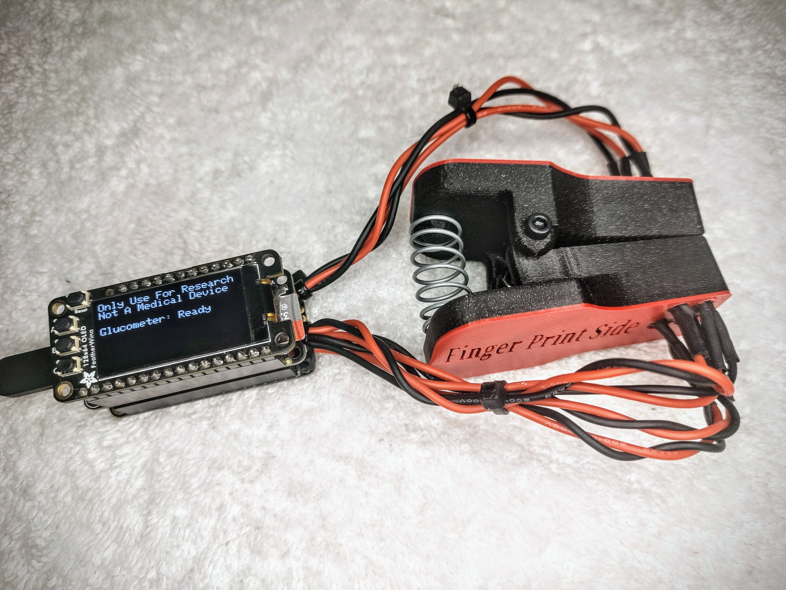

# Noninvasive Glucometer — Open Hardware Experiment

This repository documents an open hardware/software experiment in noninvasive blood-glucose sensing using optical measurements. It includes embedded data acquisition, electronics, mechanical designs, sensor logs, analysis scripts, and the design history of multiple prototype concepts.

The most important result so far is also a negative one: **the first prototype did not demonstrate a useful correlation between its optical measurements and reference blood-glucose values.** The repository preserves the design, raw data, observed failure modes, and follow-on ideas so the experiment can be inspected and reproduced rather than presenting an unsuccessful hypothesis as a successful product.

> **Not a medical device.** The designs and data in this repository have not been evaluated or approved by the FDA and are not intended to diagnose, treat, cure, prevent, or manage any disease or medical condition.

## Engineering Scope

The project spans several disciplines:

- embedded C/C++ sensor acquisition and data logging
- optical emitter/detector selection
- analog and digital electronics
- PCB and schematic development
- 3D-printed mechanical fixtures
- repeatable sensor logging
- MATLAB/post-processing analysis
- experimental iteration based on measured failure modes

Repository areas include:

- [`src/`](src/) — embedded software/library source
- [`electrical/`](electrical/) — schematics and PCB-related work
- [`mechanical/`](mechanical/) — mechanical designs and prototype images
- [`log_data/`](log_data/) — experimental sensor/reference measurements and analysis
- [`parts_list/`](parts_list/) — component information
- [`examples/`](examples/) — example usage

## Experimental Data and Consent

The repository includes pseudonymized measurements from two participants, identified in the dataset only by participant number. The published measurements include reference blood-glucose and SpO2 values used to compare the experimental optical sensor output with conventional measurements.

The participants knowingly consented to these measurements being released publicly as part of this open-source experiment. No participant names are encoded in the published measurement index.

The data should still be treated as experimental human physiological data rather than as a validated medical dataset.

## Prototype 1: Glucosan 1

Glucosan 1 used infrared/visible optical sensing to investigate whether a low-cost portable device could detect a useful signal correlated with blood glucose.

| Item | Glucosan 1 |
| --- | --- |
| Method | IR/visible optical sensing |
| Core platform | Adafruit Feather M0 Adalogger |
| Emitters | 617 nm and 940 nm |
| Detectors | 630 nm and 940 nm phototransistors |
| ADC | 12-bit acquisition |
| Display | 128x64 OLED |
| Logging | CSV or binary to SD card |
| Published data | roughly 150 logs across two participants |
| Analysis | external/post-processing, including linear regression |
| Observed correlation | weak to none |
| Approximate prototype component cost | $48.33 |

A photo of the assembled prototype is available here:



## What Failed, and What Was Learned

The first design produced weak to no useful correlation with reference glucose measurements. Larger datasets also exposed an apparent signal-integrity problem: multiple sensor channels sometimes showed very similar photoplethysmogram waveforms with small offsets or shifts, suggesting coupling or another hardware failure rather than independent sensor information.

Several experimental limitations became apparent:

### Mechanical repeatability

The flexible finger clamp improved light sealing but allowed emitter/sensor geometry to change between readings. Small position changes could produce signal changes larger than the effect the experiment was attempting to measure.

A better design should constrain optical geometry much more tightly or measure relative position so it can be included in the model.

### Motion

The first prototype did not independently measure motion or vibration. Movement can dominate small optical effects. Later concepts therefore include inertial sensing so unstable readings can be identified or rejected.

### Environmental variation

Measurements were taken in varying environments without strong control of ambient conditions. Better experimental controls are needed to distinguish sensor behavior from environmental variation.

### Channel integrity

Review of the larger dataset revealed apparent duplicated/coupled waveform behavior across channels in some later logs. That data is retained, but those logs should not be treated as independent clean sensor measurements.

These problems are why the repository does not claim that Glucosan 1 measured blood glucose successfully.

## Prototype 2: Glucosan 2

The second design was intended to address limitations observed in the first prototype and explore a wider spectral range.

| Item | Glucosan 2 concept |
| --- | --- |
| Method | IR spectrometry / optical sensing |
| Core platform | Adafruit Feather RP2040 Adalogger |
| Emitters | 670, 850, 950, 1300, and 1550 nm |
| Detector concept | silicon and InGaAs photodiodes |
| ADC / front end | analog front-end IC, 14-bit acquisition |
| Motion sensing | two accelerometers and two gyroscopes planned |
| Temperature | temperature sensing planned |
| Logging | CSV or binary to SD card |
| Approximate listed component cost | $188.31 |
| Status | design in progress / not validated |

The second concept should be understood as follow-on engineering work, not as a validated sensor.

## Data Layout

The Glucosan 1 dataset is under:

```text
log_data/Glucosan1/
├── analysis/
└── data/
```

The data directory includes:

- `Index.csv` — maps groups of sensor logs to participant number and pre/post reference measurements
- `InitialLogData.csv` / `.mat` — large sensor dataset
- `UserTwoLogData.csv` — additional dataset used to broaden the observed glucose range
- `AddLogs.m` — MATLAB data-processing support

The raw files are intentionally retained so analysis can be checked against the underlying measurements.

## Design Philosophy

The purpose of publishing this work is not to claim a medical breakthrough. It is to make the engineering experiment inspectable:

1. publish enough design information to reproduce the hardware
2. collect reference and experimental measurements
3. test whether the hypothesized relationship appears in the data
4. document failure modes when it does not
5. use those failures to drive the next hardware iteration

That cycle is more useful than reporting attractive accuracy metrics from an inadequately controlled or narrow dataset.

## Project History

The repository was originally created around an open design competition intended to encourage reproducible noninvasive-glucose experiments. The competition did not receive entries, so the repository evolved into a record of the prototype designs and experimental results.

An earlier project fund of $1,750 was set aside to support work in this area. For questions about the historical project or the designs, contact `noninvasiveglucometer@gmail.com`.

## Video

An early build/progress video is available here:

[](https://www.youtube.com/watch?v=Cop63ntB-sQ)

## References

1. Hina A, Saadeh W. *Noninvasive Blood Glucose Monitoring Systems Using Near-Infrared Technology—A Review.* Sensors. 2022;22(13):4855. doi:10.3390/s22134855.
2. Javid B, Fotouhi-Ghazvini F, Zakeri FS. *Noninvasive Optical Diagnostic Techniques for Mobile Blood Glucose and Bilirubin Monitoring.* J Med Signals Sens. 2018;8(3):125-139.
3. Meter G. *Open Source Non-Invasive Glucose Meter.* YouTube, 2015.
4. Bhuyan M. *Design and Implementation of an NIR-Technique Based Non-Invasive Glucometer using Microcontroller.* 2020.
5. Oxford Instruments. *Measuring glucose concentration: NIR absorption spectroscopy.*
6. Naresh M, Nagaraju VS, Kollem S, Kumar J, Peddakrishna S. *Non-invasive glucose prediction and classification using NIR technology with machine learning.* Heliyon. 2024;10(7):e28720.

## Authors

See [`AUTHORS`](AUTHORS) for the contributors credited by this repository.

## License

See [`LICENSE`](LICENSE).
